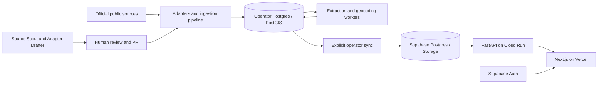

# Latent Trace architecture

How the system fits together end to end: from a county police page to a row a
citizen investigator reads on the public site. The [engineering notes](engineering-decisions.md) explain design choices, and the
[deploy runbook](deploy/runbook.md) covers ops.

For the codebase layout and entry points, see the [README](../README.md).

---

## The big picture

Two distinct planes:

- **Ingestion** turns a messy external source into canonical rows. It runs as a
  batch pipeline (CLI) or async via the ingestion worker.
- **Serving** exposes public reads and separately authenticated administration over canonical data, consumed by
  the Next.js frontend. Correlation ("possibly related cases") is computed in
  Postgres/PostGIS at request time.

Narrative extraction defaults to a local Ollama endpoint. This does not
cover every data flow: geocoding calls external providers, source tooling can
use hosted assistants, and production serving uses managed infrastructure.
See [data and privacy](data-and-privacy.md) for these boundaries.

---

## Ingestion: five adapter hooks and shared normalization

Every source implements `SourceAdapter`
([`etl/adapters/base.py`](../src/casesignal/etl/adapters/base.py)). The runner
([`etl/runners/run_pipeline.py`](../src/casesignal/etl/runners/run_pipeline.py))
drives the stages in order, recording each in `etl.ingestion_run_stage`:

| Stage | Adapter method | What it does |
|-------|----------------|--------------|
| 1. prepare_input | `prepare_input` | Fetch/scrape the source into context metadata (the parsed rows/sections/entries). Uses `polite_http` for scraped sources. |
| 2. register_source | `register_source` | Create/reuse `source_system` + `dataset_version` (keyed on a content `source_hash`) + `ingestion_run`. Shared helper: [`etl/services/source_registration.py`](../src/casesignal/etl/services/source_registration.py). |
| 3. load_raw | `load_raw` | Land the source-shaped rows into `raw_cold_case.*` (one table family per source) and/or fetch photos. |
| 4. transform | `transform` | Map raw rows → canonical `cold_case.cases` (+ `victim`, `contact`, `case_photo`), and **enqueue** `extraction_job` (Tier-1/Tier-2) and `geocoding_job` rows. |
| 5. normalize | `normalize_dataset_stage` (shared) | Canonicalize categorical fields (case_type, victim gender/race) via shared normalizers — lifted out of per-adapter transforms so every source folds the same way. |
| 6. publish | `publish` | Flip the `dataset_version` to `ingestion_status='published'`, atomically archiving the prior published version **of the same slice** (`source_system_id, source_label`). |

Public reads are gated on `ingestion_status='published'`, so a source is
invisible until publish and an admin can unpublish (→ `archived`) without
deleting rows.

**Two registration shapes** (both in `source_registration.py`):
- *Scraped* sources (most): `register_cold_case_source()` — content hash from
  the parsed rows + a hardcoded source URL.
- *File-based* sources (VA, WY, MN): `register_file_based_cold_case_source()` —
  hash from the input file via `resolve_source_hash` + a (year, state, file)
  fallback.

---

## Async workers

Three drain-then-idle daemons, each claiming the oldest job via
`FOR UPDATE SKIP LOCKED`, recovering stuck jobs on startup, and exiting cleanly
on SIGTERM after the in-flight job. Code in [`worker/`](../src/casesignal/worker/).

| Worker | Console script | Queue | Output |
|--------|----------------|-------|--------|
| Ingestion | `casesignal-ingestion-worker` | `etl.ingestion_job` | Runs the ingestion pipeline asynchronously |
| Extraction | `casesignal-extraction-worker` | `cold_case.extraction_job` | `case_extractions`, `victim_extraction`; backfills NULL `cases.incident_date`/`address` |
| Geocoding | `casesignal-geocoding-worker` | `cold_case.geocoding_job` | `cases.geom` + `geocode_precision` |

**Extraction** has two tiers, with `qwen3:14b` via local Ollama as the default:
- **Tier-1**: weapon + location_type (modus operandi).
- **Tier-2**: incident_date + address + victim age/gender (race is never
  LLM-extracted). Tier-2 is disabled for states whose source already provides
  structured demographics (CO, MN, UT, WY).

Idempotency is keyed on `(case_id, prompt_hash, model_id, prompt_tier)` —
backed by a unique index + `ON CONFLICT`. A malformed LLM response fails the job
(re-runnable), it is never persisted as a successful row.

**Geocoding** is a precision ladder (`geocoding/service.py`): Census → Google
(env-gated) → ZIP → county centroid → failed, each pin tagged with its
precision tier and provenance.

---

## Serving

- **API** ([`api/`](../src/casesignal/api/)): FastAPI read layer on Cloud Run.
  Anonymous public reads and role-checked API keys protect separate routes.
  The read-only operator dashboard uses Supabase bearer-token verification
  plus `app_auth.admin_user`; its access and API keys must be revoked separately. The cold-cases list/map/facet queries share one builder
  ([`api/services/cold_cases/filters.py`](../src/casesignal/api/services/cold_cases/filters.py)).
- **Correlation** ([`correlation/service.py`](../src/casesignal/correlation/service.py)):
  `find_correlated_cases(session, case_id)` returns the top "possibly related
  cases" for a detail page — a hard 50mi / 20yr PostGIS filter plus a weighted
  rarity-weighted MO and demographic score with a distance/time discount.
  Scores use a 0–10 scale, a 0.5 floor, and at least two matched dimensions;
  constants live in `correlation/config.py`. Framed as leads for human review, never conclusions.
- **Frontend** (`frontend/`): Next.js App Router (RSC) on Vercel, reading the
  API server-side with the Data Cache. After an ingest sync it is revalidated
  on demand (`/api/revalidate`).

---

## Data stores (schemas)

| Schema | Holds |
|--------|-------|
| `raw_cold_case.*` | Per-source raw landing tables (source-shaped, pre-canonical). |
| `cold_case.*` | Canonical domain: `cases`, `victim`, `contact`, `case_photo`, `case_extractions`, `victim_extraction`, `extraction_job`, `geocoding_job`, `extraction_review`. |
| `etl.*` | Ingestion bookkeeping: `source_system`, `dataset_version`, `ingestion_run`, `ingestion_run_stage`, `ingestion_job`. |
| `audit.*` | Audit trail. |
| `app_auth.*` | API keys (HMAC-fingerprinted) and operator-user allowlist. |

Photos live on disk locally (`CASESIGNAL_PHOTOS_ROOT`, default `data/photos/`,
gitignored) and in Supabase Storage in production.

---

## Deploy & ops

- **Postgres + PostGIS + Storage**: Supabase. **API**: Cloud Run
  (`Dockerfile.api`). **Frontend**: Vercel. Secrets in GCP Secret Manager.
- Local corpus → public via [`scripts/sync_to_supabase.sh`](../scripts/sync_to_supabase.sh).
- Backups: [`scripts/backup_corpus.sh`](../scripts/backup_corpus.sh) → GCS
  (see [RESTORE.md](RESTORE.md)).
- Full details: the [deploy runbook](deploy/runbook.md).

---

## End-to-end example

A new Howard County, MD case appears on the county PD page:

1. `cold_case_md_howard` adapter scrapes it (`prepare_input`), registers the
   dataset version (`register_source`), lands raw rows (`load_raw`), maps to
   `cold_case.cases` + enqueues extraction/geocoding jobs (`transform`),
   normalizes categoricals (`normalize`), and publishes (`publish`).
2. The extraction worker picks up the Tier-1/Tier-2 jobs → writes
   `case_extractions` and backfills the incident date/address.
3. The geocoding worker resolves the address → `cases.geom` + precision.
4. The operator reviews and syncs the published dataset and photos to the
   serving environment, then revalidates frontend caches. The public list, map,
   and detail pages can then show the record and its shared-characteristic leads.

## Source discovery and drafting

[Source Scout](runbooks/source-scout.md) prepares a registry of candidate official
sources. [Adapter Drafter](runbooks/adapter-drafter.md) captures source pages,
generates an adapter, verifies traversal and canonical mapping offline, and
finishes a reviewed branch/PR. Registry state, captures, and model transcripts
stay in ignored runtime directories.

The drafter grades generated code in a Linux Landlock/seccomp sandbox against
host-owned fixture hashes and expectations. Its offline PASS does not certify
database persistence or authorize publication. Read the
[engineering notes](engineering-decisions.md)
for the trust boundaries and remaining integration limits.
